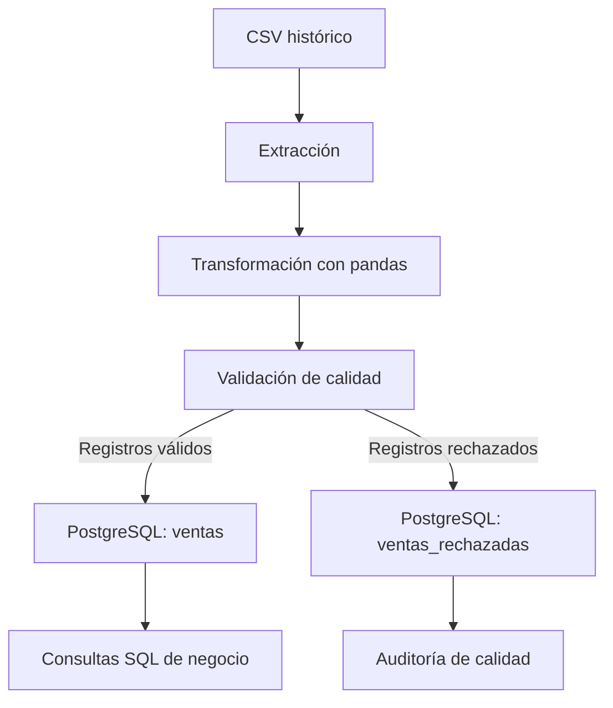

# DataMart S.A.S. — Pipeline ETL y Data Warehouse

> Prueba de desempeño: construcción de un proceso de extracción, transformación y carga (ETL), almacenamiento analítico en PostgreSQL y preparación de su orquestación con Apache Airflow.

## 1. Resumen ejecutivo

Este proyecto procesa registros históricos de transacciones comerciales, distingue ventas y devoluciones, valida reglas de calidad y almacena los resultados en PostgreSQL para su análisis mediante SQL. Incluye un notebook de exploración, módulos Python separados por responsabilidad, un DAG de Airflow con cuatro tareas y consultas analíticas.

**Estado comprobado:** el ETL se ejecutó correctamente desde Python, se verificó la persistencia en PostgreSQL y se ejecutaron siete consultas SQL. El DAG pasó una comprobación de sintaxis, pero **no ha sido ejecutado en un servicio Airflow**, ya que no se pudo descargar la imagen de Docker requerida. Por tanto, la orquestación se considera *implementada en código, pendiente de validación de ejecución*.

## 2. Objetivos

- Ingerir datos transaccionales históricos desde archivos CSV.
- Explorar las fuentes y evitar una carga duplicada de periodos superpuestos.
- Normalizar nombres de columnas, tipos de datos y fechas.
- Clasificar ventas y devoluciones y calcular importes.
- Rechazar registros que incumplan las reglas de calidad definidas.
- Cargar registros válidos y rechazados en tablas PostgreSQL separadas.
- Preparar un DAG diario con dependencias explícitas entre etapas.
- Consultar resultados comerciales y de calidad mediante SQL.

## 3. Tecnologías y componentes

| Componente | Tecnología | Uso |
|---|---|---|
| Lenguaje | Python 3.12 | Transformación, validación y carga |
| Manipulación de datos | pandas 2.2.3 | Lectura de CSV y procesamiento tabular |
| Conexión a base de datos | psycopg2-binary | Inserciones en PostgreSQL |
| Variables de entorno | python-dotenv | Configuración local sin credenciales en el código |
| Data Warehouse | PostgreSQL 16 | Almacenamiento y consultas analíticas |
| Infraestructura local | Docker Compose | Servicios de bases de datos |
| Orquestación prevista | Apache Airflow 2.10.5 | Programación y dependencias del DAG |
| Exploración | Jupyter Notebook | Perfilamiento de fuentes |
| Consultas | SQL | Indicadores comerciales y auditoría |

**Nota:** la presencia de un DAG en el repositorio no equivale a disponer de un servidor Airflow operativo.

## 4. Estructura del proyecto

```text
datamart_prueba_oficial/
├── .env                         # Configuración privada local; no versionar
├── docker-compose.yml           # PostgreSQL de metadatos y Data Warehouse
├── Dockerfile.airflow           # Imagen Airflow prevista; build pendiente
├── README.md
├── config/
├── dags/
│   └── dag_datamart.py          # DAG diario: cuatro tareas
├── data/
│   ├── raw/
│   │   ├── ventas_2009_2011.csv
│   │   └── ventas_2010_2011.csv
│   ├── processed/               # Archivos intermedios del DAG
│   └── rejected/                # Archivos intermedios de rechazos
├── docs/
├── etl/
│   ├── transformacion_ventas.py
│   ├── validacion_ventas.py
│   ├── carga_ventas.py
│   └── ejecucion_etl.py
├── logs/
├── notebooks/
│   └── 01_exploracion_datos.ipynb
├── plugins/
├── sql/
│   ├── 02_consultas_negocio.sql
│   └── init/
│       └── 01_creacion_tablas.sql
└── tests/
```

Algunas carpetas son espacios reservados para futuras ampliaciones; no se presupone que contengan pruebas o documentación adicional.

## 5. Origen de los datos y exploración

| Archivo | Registros | Observaciones |
|---|---:|---|
| `ventas_2009_2011.csv` | 1.067.371 | Fuente principal del ETL |
| `ventas_2010_2011.csv` | 541.909 | Fuente contrastada, no concatenada |

**Columnas de la fuente principal:** `Invoice`, `StockCode`, `Description`, `Quantity`, `InvoiceDate`, `Price`, `Customer ID`, `Country`.

**Columnas de la segunda fuente:** `InvoiceNo`, `StockCode`, `Description`, `Quantity`, `InvoiceDate`, `UnitPrice`, `CustomerID`, `Country`.

### 5.1 Hallazgos exploratorios

En el archivo histórico se observaron 4.382 descripciones faltantes, 243.007 identificadores de cliente faltantes y 34.335 filas exactamente duplicadas. En el archivo más reciente se observaron 5.268 filas exactamente duplicadas.

Se verificó que los 25.900 identificadores únicos de factura de la segunda fuente aparecen en el histórico y que sus 536.478 combinaciones únicas de factura, producto y cantidad también aparecen allí. **Esto justifica una decisión conservadora de no concatenar ambas fuentes**, aunque no demuestra que cada fila sea idéntica en todos sus campos. La equivalencia integral de los archivos requeriría una reconciliación adicional.

### 5.2 Fuente elegida

El pipeline operativo procesa `ventas_2009_2011.csv`. El archivo `ventas_2010_2011.csv` se utiliza como referencia de exploración y comparación, pero no se carga nuevamente para reducir el riesgo de doble contabilización.

## 6. Arquitectura y flujo de datos



En la ejecución manual, `etl/ejecucion_etl.py` coordina el proceso en una sola ejecución. El DAG define las mismas responsabilidades en cuatro tareas encadenadas y utiliza archivos intermedios `pickle` dentro de las carpetas de datos compartidas. Los archivos `pickle` deben considerarse artefactos internos confiables; **nunca deben cargarse desde fuentes desconocidas**.

## 7. Transformación de datos

Implementada en `etl/transformacion_ventas.py`.

| Columna de origen | Columna normalizada | Tratamiento |
|---|---|---|
| `Invoice` | `factura` | Texto sin espacios extremos |
| `StockCode` | `producto` | Texto sin espacios extremos y en mayúsculas |
| `Description` | `descripcion` | Se conserva, incluidos valores faltantes |
| `Quantity` | `cantidad` | Conversión numérica |
| `InvoiceDate` | `fecha` | Conversión a fecha con interpretación UTC |
| `Price` | `precio` | Conversión numérica |
| `Customer ID` | `cliente` | Identificador opcional |
| `Country` | `pais` | Se conserva |

Se añaden:

- `tipo_movimiento`: `devolucion` cuando la factura comienza por `C` o la cantidad es negativa; en los demás casos, `venta`.
- `total`: `cantidad * precio`.

**Consideración temporal:** el CSV no documenta explícitamente una zona horaria. El uso de UTC es una decisión técnica del procesamiento, no una afirmación sobre la zona horaria original.

## 8. Reglas de validación

Implementadas en `etl/validacion_ventas.py`.

Se rechaza un registro cuando ocurre alguna de estas condiciones:

1. Factura nula o vacía.
2. Código de producto nulo o vacío.
3. Fecha inválida o ausente.
4. Cantidad inválida, ausente o igual a cero.
5. Precio inválido, ausente o negativo.
6. Movimiento clasificado como venta con precio igual a cero.

Los registros rechazados se almacenan para auditoría con el motivo general `Registro con datos obligatorios inválidos`. La validación no asigna todavía un código específico por cada causa de rechazo.

Los clientes faltantes se conservan como valores nulos, en lugar de inventar identificadores. Las devoluciones se conservan como movimientos separados para análisis.

## 9. Modelo de datos PostgreSQL

El script `sql/init/01_creacion_tablas.sql` crea las tablas e índices.

### 9.1 Tabla `ventas`

| Campo | Tipo | Propósito |
|---|---|---|
| `id` | `BIGSERIAL` | Identificador interno |
| `clave_registro` | `VARCHAR(64) UNIQUE` | Control de recargas por contenido |
| `factura` | `VARCHAR(50)` | Identificador de factura |
| `producto` | `VARCHAR(50)` | Código de producto |
| `descripcion` | `TEXT` | Descripción comercial |
| `cantidad` | `NUMERIC(12,2)` | Unidades |
| `fecha` | `TIMESTAMPTZ` | Fecha del movimiento |
| `precio` | `NUMERIC(14,2)` | Precio unitario |
| `cliente` | `VARCHAR(50)` | Identificador opcional |
| `pais` | `VARCHAR(100)` | País |
| `tipo_movimiento` | `VARCHAR(20)` | Venta o devolución |
| `total` | `NUMERIC(16,2)` | Importe del movimiento |
| `fuente` | `VARCHAR(100)` | Archivo de procedencia |
| `fecha_carga` | `TIMESTAMPTZ` | Momento de inserción |

Índices en `fecha`, `producto`, `pais` y `tipo_movimiento` para favorecer consultas analíticas frecuentes.

### 9.2 Tabla `ventas_rechazadas`

Contiene `id`, `clave_registro`, `fuente`, `motivo`, `datos_originales` (JSONB) y `fecha_rechazo`. Permite inspeccionar datos que no superaron la validación.

### 9.3 Idempotencia y advertencia sobre duplicados

La carga genera una huella SHA-256 a partir de varios campos de cada registro y utiliza `ON CONFLICT (clave_registro) DO NOTHING`. Así se evitan reinserciones de filas con la misma representación de contenido.

**Limitación relevante:** dos líneas de factura legítimamente distintas pero idénticas en esos campos pueden recibir la misma huella y consolidarse. Esta estrategia no equivale a disponer de una clave transaccional de origen. Antes de un uso productivo sería necesario definir una clave de línea estable o incorporar la posición original de la fila, conservando la idempotencia entre ejecuciones.

## 10. Configuración local

### 10.1 Requisitos

- Windows con PowerShell (entorno utilizado para las pruebas) o terminal equivalente.
- Python 3.12 y un entorno virtual.
- Docker Desktop con Docker Compose.
- Dependencias Python: `pandas`, `psycopg2-binary` y `python-dotenv`.
- Espacio y memoria suficientes para procesar más de un millón de registros.

### 10.2 Variables de entorno

Crear `.env` en la raíz del proyecto con valores privados apropiados:

```dotenv
AIRFLOW_DB_USER=usuario_metadatos
AIRFLOW_DB_PASSWORD=definir_clave_segura
AIRFLOW_DB_NAME=airflow
WAREHOUSE_DB_HOST=localhost
WAREHOUSE_DB_PORT=5544
WAREHOUSE_DB_NAME=datamart
WAREHOUSE_DB_USER=datamart
WAREHOUSE_DB_PASSWORD=definir_clave_segura
```

Los valores son ejemplos; deben coincidir con las credenciales reales del contenedor. **No publicar el `.env` ni credenciales reales en GitHub.**

La aplicación Python local se conecta al Data Warehouse a través de `localhost:5544`, puerto publicado por Docker. Dentro de un contenedor Airflow que comparta la red de Compose, la conexión deberá usar `postgres_warehouse:5432`.

### 10.3 Arrancar PostgreSQL

Desde la raíz del proyecto:

```powershell
docker compose up -d postgres_airflow postgres_warehouse
docker compose ps
```

El servicio `postgres_airflow` proporciona únicamente la base de datos prevista para metadatos: **no inicia por sí mismo Airflow**. El servicio `postgres_warehouse` contiene las tablas analíticas.

### 10.4 Crear o verificar las tablas

El directorio `sql/init` está montado en `/docker-entrypoint-initdb.d` del contenedor PostgreSQL. Estos scripts se ejecutan automáticamente **solo cuando el volumen de datos se inicializa por primera vez**. Si el volumen ya existe, se puede aplicar manualmente:

```powershell
Get-Content ".\sql\init\01_creacion_tablas.sql" -Raw |
    docker compose exec -T postgres_warehouse psql -v ON_ERROR_STOP=1 -U datamart -d datamart
```

El script utiliza `IF NOT EXISTS` para tablas e índices, pero los cambios futuros de esquema deberían administrarse mediante migraciones.

## 11. Ejecución manual del ETL

Con el entorno virtual activado y desde la raíz del proyecto:

```powershell
python -m etl.ejecucion_etl
```

El módulo:

1. Lee `data/raw/ventas_2009_2011.csv` con codificación `latin-1`.
2. Transforma los datos con pandas.
3. Separa filas válidas y rechazadas.
4. Carga ambas categorías en PostgreSQL.
5. Informa los conteos y el resultado de la ejecución.

La carga se realiza mediante `psycopg2` y operaciones `INSERT ... ON CONFLICT DO NOTHING`. En caso de error de inserción, la transacción correspondiente debe revertirse; el código utiliza un contexto transaccional de conexión.

## 12. DAG de Apache Airflow

Archivo: `dags/dag_datamart.py`.

| Parámetro | Configuración |
|---|---|
| ID | `datamart_etl_diario` |
| Descripción | Pipeline diario de ventas y devoluciones |
| Inicio definido | 2026-10-01 |
| Frecuencia | `@daily` |
| `catchup` | `False` |
| Reintentos | 1 |
| Espera entre reintentos | 5 minutos |
| Etiquetas | `etl`, `ventas`, `warehouse` |

Flujo de dependencias:

```text
extraccion >> transformacion >> validacion >> carga
```

- **extraccion:** verifica que exista el archivo CSV de origen.
- **transformacion:** lee el CSV, aplica reglas de transformación y guarda un DataFrame intermedio.
- **validacion:** separa registros válidos y rechazados en archivos intermedios.
- **carga:** inserta los resultados en PostgreSQL.

Las tareas no intercambian el millón de filas mediante XCom; utilizan archivos internos en las carpetas `data/processed` y `data/rejected`, que deben estar disponibles para todos los procesos que ejecuten el DAG.

### 12.1 Comprobación realizada

```powershell
python -m py_compile .\dags\dag_datamart.py
```

La comprobación terminó sin errores de sintaxis. **No verifica que los imports de Airflow estén disponibles ni que el DAG se ejecute correctamente**.

### 12.2 Ejecución real pendiente

La construcción de la imagen de Airflow falló por problemas de acceso al registro de imágenes Docker Hub. No se dispone de evidencia de ejecución del DAG en un scheduler o webserver Airflow.

Antes de declarar terminada la orquestación se requiere:

1. Disponer de una imagen funcional de Airflow con las dependencias Python.
2. Configurar los servicios de Airflow (inicialización, scheduler y webserver) en Docker Compose.
3. Montar `dags/`, `etl/` y `data/` en rutas compatibles con `/opt/airflow`.
4. Configurar la conexión interna al Data Warehouse: `postgres_warehouse:5432`.
5. Comprobar que Airflow detecta el DAG y que sus cuatro tareas finalizan correctamente.
6. Capturar logs o evidencia de ejecución para la entrega.

**No ejecutar el DAG en un contenedor sin corregir primero el host y puerto de la conexión:** `localhost:5544` corresponde a la ejecución desde Windows, no desde el contenedor Airflow.

## 13. Consultas analíticas

Archivo: `sql/02_consultas_negocio.sql`.

Ejecutar:

```powershell
Get-Content ".\sql\02_consultas_negocio.sql" -Raw |
    docker compose exec -T postgres_warehouse psql -v ON_ERROR_STOP=1 -U datamart -d datamart
```

Incluye siete consultas verificadas:

1. Resumen por tipo de movimiento.
2. Diez países con mayor valor de ventas.
3. Diez códigos de producto con mayor valor de ventas.
4. Evolución mensual del valor vendido.
5. Diez clientes con mayor valor de compras.
6. Número e importe absoluto de devoluciones.
7. Conteo de registros almacenados y rechazados.

## 14. Resultados verificados

### 14.1 Resultado del procesamiento

| Indicador | Registros |
|---|---:|
| Filas leídas del CSV histórico | 1.067.371 |
| Válidas antes de deduplicación | 1.064.621 |
| Rechazadas antes de deduplicación | 2.750 |
| Almacenadas en `ventas` | 1.030.410 |
| Almacenadas en `ventas_rechazadas` | 2.626 |

Las cantidades almacenadas son inferiores a las procesadas porque la huella de contenido y las restricciones únicas consolidan registros coincidentes. Por ello, los conteos de tablas **no deben presentarse como un recuento de todas las líneas físicas originales**.

### 14.2 Indicadores comerciales

| Indicador | Resultado |
|---|---:|
| Movimientos clasificados como venta | 1.007.913 |
| Movimientos clasificados como devolución | 22.497 |
| Importe agregado de ventas | 20.476.260,43 |
| Importe neto agregado de movimientos de devolución | -1.462.050,61 |
| Suma absoluta de importes de devolución | 1.462.797,75 |
| País con mayor importe de ventas | United Kingdom: 17.410.196,10 |
| Mes con mayor importe de ventas | Noviembre de 2011: 1.503.866,78 |

**Importante:** los CSV no acreditan de manera explícita la moneda. Los importes se muestran sin asignar una divisa. La suma absoluta de devoluciones difiere del importe neto de devoluciones porque hay movimientos clasificados como devolución cuyo importe no es negativo. Los importes de venta no equivalen a utilidad, ya que no se dispone de costos.

### 14.3 Interpretación

La actividad está fuertemente concentrada en United Kingdom. Las consultas mensuales permiten estudiar estacionalidad y los rankings de productos y clientes facilitan análisis comerciales. Los registros rechazados se conservan para auditar la calidad de la fuente, en lugar de descartarse sin trazabilidad.

## 15. Verificaciones realizadas y pendientes

| Verificación | Estado | Evidencia |
|---|---|---|
| Lectura y exploración de CSV | Realizada | Notebook y conteos de exploración |
| Transformación y validación | Realizada | Conteos del ETL manual |
| Inserción en PostgreSQL | Realizada | 1.030.410 ventas y 2.626 rechazados |
| Consultas SQL de negocio | Realizada | Siete resultados obtenidos en `psql` |
| Sintaxis de DAG | Realizada | `py_compile` sin errores |
| Importación y registro del DAG en Airflow | Pendiente | No se inició Airflow |
| Ejecución programada o manual del DAG | Pendiente | No hay logs de tareas |
| Prueba de reinicio/reintento en Airflow | Pendiente | Requiere entorno Airflow funcional |
| Pruebas automatizadas unitarias | No acreditadas | No se aportó evidencia de ejecución |

## 16. Limitaciones y mejoras propuestas

- **Modelo analítico:** el proyecto utiliza una tabla de movimientos y otra de rechazos, no un esquema estrella con dimensiones y tabla de hechos. Si la rúbrica exige modelado dimensional, deberá implementarse explícitamente.
- **Deduplicación:** la huella por contenido puede fusionar líneas de venta legítimas idénticas.
- **Calidad:** los rechazos tienen un motivo general, no un catálogo detallado de reglas incumplidas.
- **Fecha y moneda:** no se confirmó la zona horaria original ni la moneda de los importes.
- **Orquestación:** falta ejecutar Airflow y capturar evidencia de cada tarea.
- **Operación:** el DAG actual relee todo el histórico; una versión productiva debería contemplar carga incremental, particionamiento o control de lotes.
- **Concurrencia:** los archivos intermedios tienen nombres fijos; se debe evitar ejecutar simultáneamente varias instancias del mismo pipeline o aislar los archivos por identificador de ejecución.
- **Seguridad:** credenciales mediante variables de entorno, `.env` excluido del control de versiones y acceso restringido a los archivos intermedios.
- **Pruebas:** añadir pruebas unitarias, de integración y validaciones de integridad de datos.

## 17. Guía breve para el evaluador

1. Revisar la exploración en `notebooks/01_exploracion_datos.ipynb`.
2. Revisar las reglas de negocio en `etl/transformacion_ventas.py` y `etl/validacion_ventas.py`.
3. Inspeccionar el modelo de datos en `sql/init/01_creacion_tablas.sql`.
4. Iniciar PostgreSQL con Docker Compose y configurar `.env`.
5. Ejecutar `python -m etl.ejecucion_etl`.
6. Consultar las tablas mediante `sql/02_consultas_negocio.sql`.
7. Revisar la definición de tareas en `dags/dag_datamart.py`.
8. Tener presente que la ejecución efectiva de Airflow aún no está acreditada.

## 18. Conclusión

Se construyó y ejecutó un pipeline ETL manual capaz de procesar más de un millón de registros históricos, aplicar reglas de calidad, almacenar movimientos y rechazos en PostgreSQL y generar indicadores comerciales con SQL. Se preparó un DAG de cuatro tareas para la automatización diaria, pendiente de despliegue y validación de ejecución en Apache Airflow. La solución es una base funcional para análisis de ventas y devoluciones, con limitaciones documentadas y mejoras identificadas para una implementación productiva.
