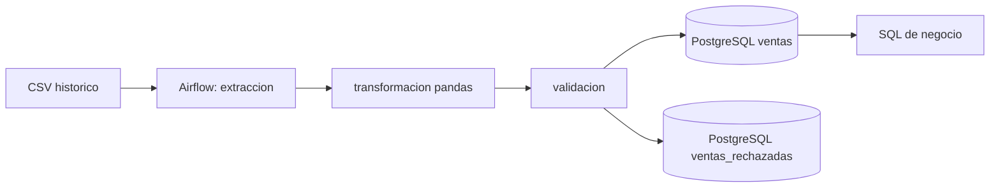

# Arquitectura y decisiones del DataMart

## Flujo operativo comprobado

## Datos y granularidad
El historico contiene 1.067.371 filas; el dataset 2010-2011 contiene 541.909 filas. Existe solapamiento considerable entre ambas fuentes. La implementacion actual usa el historico como fuente de carga y el reciente para exploracion, no para union directa. Una reconciliacion fila a fila sigue pendiente.

La tabla `ventas` es transaccional plana, no esquema estrella. El hash comercial evita reinserciones pero puede colapsar lineas legitimas identicas: 34.211 filas validas repetidas, importe neto asociado 431.716,87. Estas cifras no demuestran perdidas de ingresos ni errores de negocio; cuantifican un riesgo de integridad.

## Reglas
- `factura` y `producto` obligatorios; cantidad distinta de cero; fecha valida.
- Precio no negativo; ventas con precio cero rechazadas.
- Devolucion: factura que comienza con C o cantidad negativa.
- Clientes faltantes permanecen nulos.
- `total = cantidad * precio`.
- Las fechas se convierten a UTC pese a que la zona horaria original no esta documentada.

## Infraestructura
- Airflow 2.10.5, LocalExecutor, DAG `datamart_etl_diario` con cuatro tareas.
- PostgreSQL 16 para metadatos Airflow y PostgreSQL 16 separado para warehouse.
- Docker Compose dividido entre `docker-compose.yml` y `docker-compose.airflow.yml`.
- Archivos pickle intermedios en volumen local: no aceptar pickle de fuentes desconocidas.
- El SQL de `sql/init/` solo se ejecuta automaticamente cuando el volumen PostgreSQL es nuevo.
- Configuracion de warehouse mediante variables de entorno Docker, no Airflow Connections/Variables.

## Decisiones estrategicas pendientes
1. Identificador de linea por version de archivo y posicion para idempotencia sin colapsar filas identicas.
2. Reconciliacion entre fuentes antes de combinar registros.
3. Clasificacion comercial de productos con reglas verificables, no segmentos tecnicos como categorias reales.
4. Evaluacion de esquema estrella frente a vistas analiticas, con pruebas de costo y exactitud.
5. Prueba de instalacion limpia y documentacion de tiempos.

## SQL
Las siete preguntas del enunciado estan en `sql/03_preguntas_negocio.sql`. Se verifico que el archivo ejecuta sin errores SQL; la validez semantica y el resultado de cada pregunta deben revisarse por separado.
