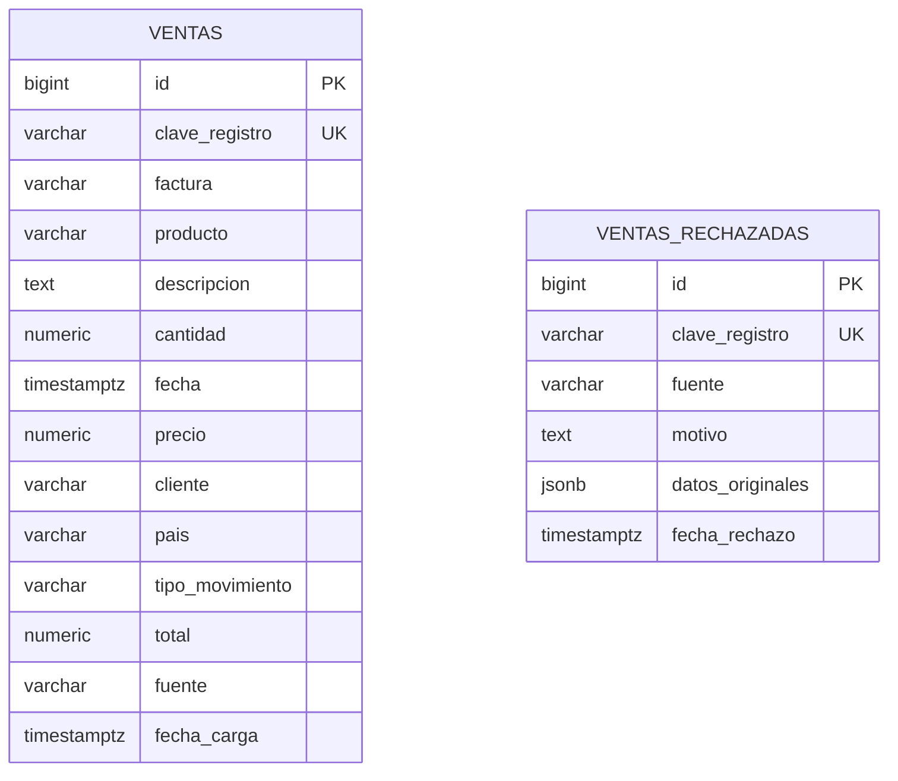
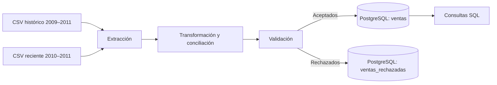

# Modelo de datos y flujo ETL — DataMart S.A.S.

Esta guía explica dónde quedan los datos, cómo se procesan y qué decisiones afectan la interpretación de los resultados.

## 1. Modelo de datos implementado

**`ventas`** guarda las transacciones que superan las validaciones. **`ventas_rechazadas`** conserva los registros descartados y sus motivos, para poder auditarlos.

Son tablas independientes: un rechazo no tiene una clave foránea hacia `ventas`. El modelo es **plano**, no un esquema estrella con dimensiones de clientes, productos o países.

La columna `clave_registro` identifica cada línea física de entrada mediante SHA-256 de `fuente_origen|numero_fila_origen`. Así se conservan dos líneas aunque tengan los mismos valores comerciales.

## 2. Recorrido de los datos

El DAG `datamart_etl_diario` organiza las etapas `extraccion → transformacion → validacion → carga` y se programa diariamente con `@daily`.

**Conciliación de archivos:** se toma el histórico como base y se añaden de la fuente reciente únicamente las facturas que no aparecen en el histórico. En la ejecución documentada no hubo facturas nuevas. Este criterio evita duplicar facturas, pero no garantiza que dos versiones de una factura tengan líneas idénticas.

## 3. Resultados comprobados

| Resultado | Valor |
|---|---:|
| Registros válidos en `ventas` | 1.064.621 |
| Registros en `ventas_rechazadas` | 2.750 |
| Importe neto total en `ventas` | 19.445.926,69 |

Después de reconstruir el almacén con la clave de origen y fila, se repitió la carga normal y **no cambiaron los conteos ni el importe**. La prueba y sus capturas están en [evidencias](../evidencias/README.md).

La reconstrucción con `DATAMART_REBUILD=1` utiliza tablas temporales, comprueba recuentos y reemplaza los datos dentro de una transacción. Se realizó con un respaldo local previo, que no se publica en GitHub. Para ejecuciones habituales se mantiene `DATAMART_REBUILD=0`.

## 4. Límites que debe conocer quien analice los resultados

1. **Identidad de filas:** la clave depende del nombre y de la posición original de cada línea del CSV. Reordenar o sustituir un archivo puede cambiar esa identidad.
2. **Fuentes solapadas:** la conciliación por factura no comprueba diferencias línea por línea entre los dos archivos.
3. **Categorías:** el dataset no aporta categorías comerciales verificadas. La consulta que agrupa por formato del código usa segmentos técnicos, no categorías reales.
4. **Modelo de análisis:** las consultas se realizan sobre una tabla plana; no se implementó un modelo dimensional en estrella.
5. **Moneda:** no se atribuye una divisa al importe sin evidencia del origen.
6. **Reproducción:** para instalar desde cero se necesitan los CSV originales, las credenciales de `.env` y la Connection de Airflow `datamart_warehouse`. No se ha validado de forma independiente el tiempo de puesta en marcha desde una clonación limpia.

## 5. Dónde encontrar el análisis

- [Siete preguntas de negocio y sus consultas SQL](../sql/03_preguntas_negocio.sql).
- [Cuatro capturas de ejecución y verificación](../evidencias/README.md).
- [Instrucciones para ejecutar el proyecto](../README.md).
