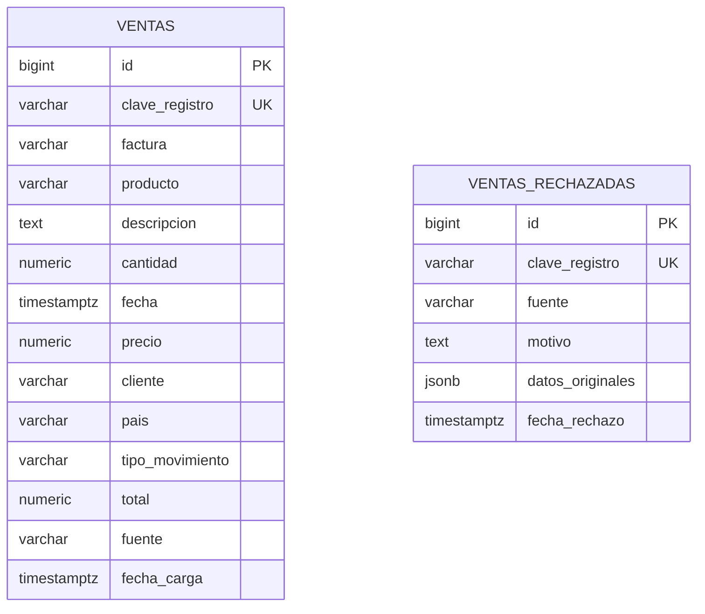
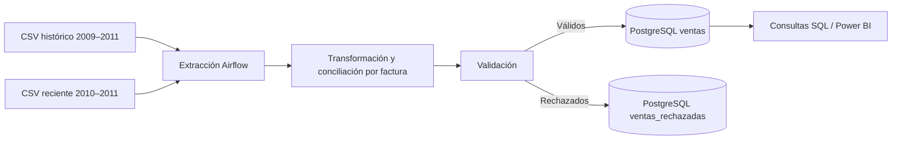

# Modelo de datos — DataMart S.A.S.

## Diagrama entidad-relación (modelo físico implementado)

Las tablas son independientes: `ventas_rechazadas` es una bitácora de calidad, no tiene una clave foránea hacia `ventas`. El warehouse implementado es **plano**, no un esquema estrella; no se presentan dimensiones inexistentes.

## Flujo de datos

## Limitaciones y riesgos conocidos

1. **Idempotencia:** `clave_registro` es SHA-256 de los valores comerciales. Reejecutar la misma fuente no duplica registros, pero dos líneas legítimas idénticas también se reducen a una. Se identificaron 34.335 filas adicionales idénticas en el CSV histórico; no se ha demostrado si son errores de origen o transacciones legítimas. **No interpretar automáticamente todas como errores.**
2. **Conciliación de fuentes:** la segunda fuente comparte todas sus facturas con el histórico. La estrategia actual descarta facturas ya presentes, no compara cada línea individual; puede ocultar diferencias entre versiones de una misma factura.
3. **Categorías:** los segmentos derivados del formato de `StockCode` no equivalen a categorías comerciales verificadas.
4. **Modelo:** se implementó una tabla de hechos plana, no un modelo dimensional con dimensiones conformadas.
5. **Migración futura:** antes de cambiar la clave a origen + posición de fila, validar inmutabilidad del archivo, checksum, reconstrucción en tablas temporales y reconciliación de filas y totales. Se generó un respaldo local previo de ambas tablas, que no se incluye en GitHub.

## Reproducibilidad

Los CSV originales y credenciales están excluidos de Git. Para una instalación limpia se deben aportar ambas fuentes en `data/raw/`, configurar `.env`, levantar los servicios y configurar la conexión Airflow `datamart_warehouse`. Una ejecución completa desde clonación limpia aún requiere verificación independiente.
