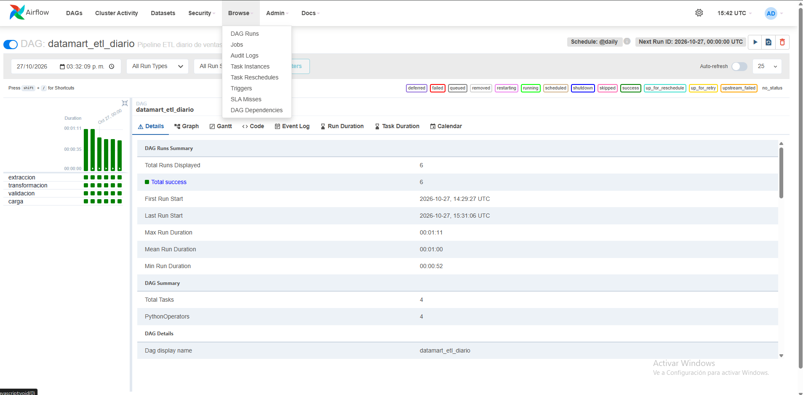
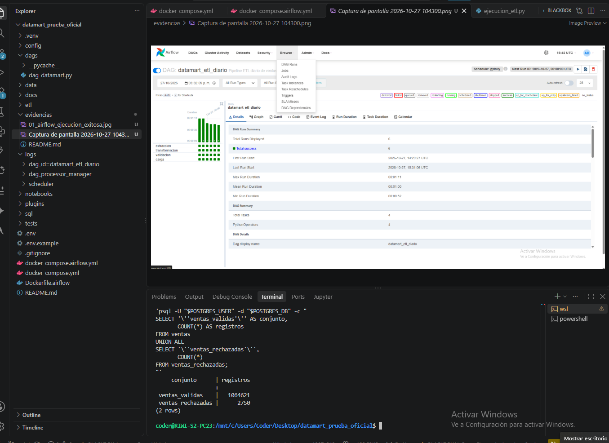
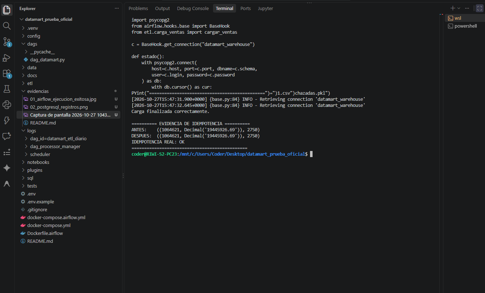
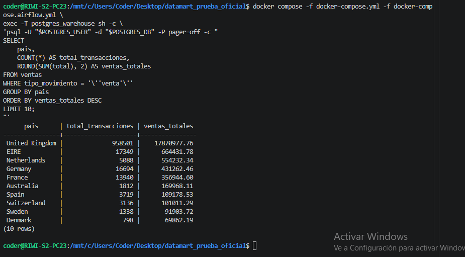

# Evidencias de ejecución — DataMart S.A.S.

Fecha: 27 de octubre de 2026.

## 01 — Orquestación Apache Airflow

- DAG: `datamart_etl_diario`.
- Programación: `@daily`.
- Tareas: `extraccion`, `transformacion`, `validacion`, `carga`.
- Captura compartida en la conversación: 6 ejecuciones exitosas de 6; cuatro tareas en verde.
- Última ejecución mostrada: 2026-10-27 15:31:06 UTC.


## 02 — Reconciliación y carga PostgreSQL

Resultado tras la reconstrucción transaccional y la carga ordinaria:

| Métrica | Valor |
|---|---:|
| Filas de entrada histórica | 1.067.371 |
| Filas de entrada reciente | 541.909 |
| Ventas válidas almacenadas | 1.064.621 |
| Ventas rechazadas almacenadas | 2.750 |
| Total de ventas almacenadas | 19.445.926,69 |

Nota: los archivos históricos y recientes se solapan; no deben sumarse directamente como si fueran ventas distintas. La lógica de extracción prioriza el histórico y agrega del reciente las facturas ausentes; en esta ejecución se informaron cero facturas nuevas.



## 03 — Prueba de idempotencia

Se repitió la carga ordinaria con `DATAMART_REBUILD=0`, usando los mismos conjuntos procesados. La comprobación realizada contra PostgreSQL arrojó:

```text
ANTES: ((1064621, Decimal('19445926.69')), 2750)
Carga finalizada correctamente.
DESPUÉS: ((1064621, Decimal('19445926.69')), 2750)
IDEMPOTENCIA REAL: OK
```

**Conclusión:** la segunda carga no modificó la cantidad de registros válidos, rechazados ni el total monetario. La identidad del registro utiliza SHA-256 de `fuente_origen|numero_fila_origen`, por lo que la repetición del procesamiento de los mismos archivos es idempotente.



## 04 — Consultas de negocio

Archivo de consultas: [`sql/03_preguntas_negocio.sql`](../sql/03_preguntas_negocio.sql). El archivo contiene siete preguntas de negocio y sus consultas SQL. Se incluye una captura de la consulta de ventas por país ejecutada en PostgreSQL.



## 05 — Diagramas y documentación

[Modelo de datos y diagramas](../docs/modelo_datos_diagramas.md).

## Alcance y pendientes

Este documento registra resultados observados y reportados durante la ejecución. Las cuatro capturas de Airflow, PostgreSQL, idempotencia y consultas SQL ya están incorporadas y enlazadas en este documento. El dashboard Power BI es un componente aparte, pendiente si se decide realizarlo.
